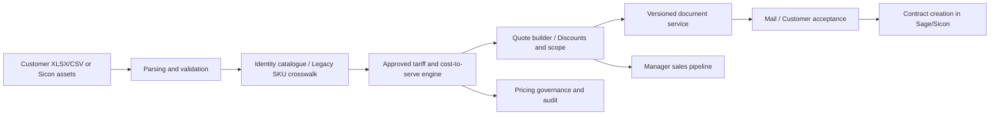

# Pulse Fitness SmartQuote — Production Architecture and Delivery Plan

## North star

A coordinator can upload a poor-quality equipment register, verify rare exceptions, select the maintenance package and issue an accurate Pulse-branded quote in **under five minutes for routine lists**, with zero hidden guesses about machinery or pricing. Five minutes is a future UAT target, not an existing measured result.

## Logical architecture

## Phase 1 — Stabilisation (substantial pilot implementation in V6)

- Fix imported quantity coercion, manual discount application and price multiplication rounding.
- Persist quoted PDFs as numbered, integrity-checked versions.
- Restrict local master-data changes to signed-in manager roles.
- Detect category/console/model changes during master import.
- Reuse local customer information, autosave forms and provide a register export.
- Provide recorded pipeline labels separately from actual order acceptance.

Remaining: independent commercial reconciliation and acceptance testing by coordinators.

## Phase 2 — Production infrastructure (requires company IT)

- Replace SQLite with centrally hosted PostgreSQL, transactional migrations and strict concurrent revision checks; deploy managed HTTPS service and an isolated production environment.
- Integrate with Pulse corporate SSO (e.g. Entra ID, if authorised), MFA, role assignment and automated joiner/mover/leaver policies.
- Add structured application logging, versioned backups, offsite immutable PDF storage, restore drills and monitoring.
- Protect uploads using MIME/content validation, file-size limits and malware inspection. Monitor quote API access and protect sessions against brute-force and stolen tokens.
- Add test/staging environments, CI/CD, version-controlled pricing rules and rollback procedures.

## Phase 3 — Commercial governance

- Have Finance/Contracts approve the maintenance pricing source rules and package wording once centrally. Routine approved quotes should then complete without manager intervention.
- Add price-rule effective dates, evidence, controlled maximum discounts, below-margin exceptions, catalogue change previews and impact analysis.
- Introduce a calculated cost-to-serve floor using Sicon history: actual PPM time, reactive calls, parts, engineer travel, third-party service cost, age/risk and site density. Never auto-infer a margin from RRP alone.
- Backtest the proposed price engine against representative signed contracts and service costs; document model assumptions and approvals.

## Phase 4 — Customer acceptance and service handoff

- Connect Sage 200/Sicon for customer/account number, site, equipment asset ID, equipment SKU and installed warranty status. Sicon API endpoints and required permissions must be confirmed; do not assume writes are available.
- Add controlled email delivery via a Pulse-approved service, delivery/failure records, accepted/signed status and secure customer approval links.
- Create maintenance agreements from the accepted quote with the approved legal schedules; preserve exact quoted equipment, scope, discount, contract term and dates.
- Only after reconciliation, create/update the contract in the authoritative service system; use idempotency keys to prevent duplicate contract creation.

## Phase 5 — Business intelligence and AI assistance

- Track median time-to-quote, match precision/recall, coordinator correction rate, accepted annual recurring maintenance value, win/loss reasons, renewal dates and realised service margin.
- Add AI-assisted parsing/explanation for unfamiliar equipment only as a *recommendation*, never silently overwriting an equipment identity, source SKU or approved price.
- Monitor renewal opportunities using contract end dates once Sage/Sicon is connected. No renewal scheduling exists in local V6.

## Interfaces to confirm with Sicon/Sage

| Data | Read requirement | Future write requirement |
|---|---|---|
| Customer | Account ID, name, billing data, terms | Only if approved customer create/update operation exists |
| Site | Unique location ID/address, contract coverage | Confirm site linkage on accepted contract |
| Assets | Item/SKU, manufacturer/model, console, serial, warranty status | Link approved quote items to site contract |
| Contracts | Existing terms, number, dates, service package, invoicing | Create/amend with external idempotency reference |
| Service jobs | Labour duration, travel, parts, first-time fix, PPM/reactive category | None required for pricing analytics |
| Audit | Last changed date and source | Log quote ID and issued snapshot SHA-256 |

## Measurable production success criteria

- 100% of released quote line values reconcile to shown quantities/unit prices and documented tariff rules, excluding only clearly explained rounding policy.
- 100% of issued PDFs can be retrieved in their original form even after catalogue revisions.
- Zero silent invalid quantity corrections; every imported exception visible to coordinators.
- No unauthenticated catalogue changes; least-privilege role testing passes.
- Target: 95%+ correct exact/current SKU mapping on labelled test files (measure, do not assume).
- Target: routine quote creation in five minutes or less for agreed representative assets, verified by user testing.
- Full restore exercise, commercial authorisation and contract terms approved before general rollout.

## Dependencies / decisions needed from Pulse

1. Written tariff, discount-floor, package and legal-term approval.
2. Sage/Sicon API access, endpoint documentation, identity mapping and test environment.
3. Company-approved hosting, SSO/email providers, security owners and backup procedures.
4. Historical parts, labour, travel and maintenance costs needed to establish actual profitability.
5. Two coordinator pilot testers and the service/pricing owner to sign the UAT results.

**This roadmap is an implementation specification. The live integrations and multi-user deployment cannot be asserted as complete without these dependencies.**
